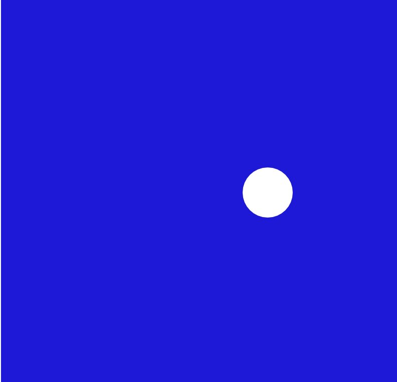
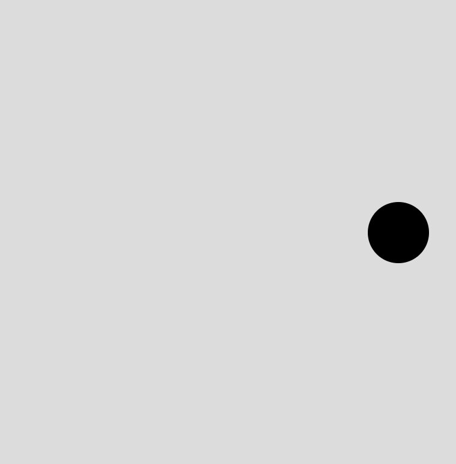
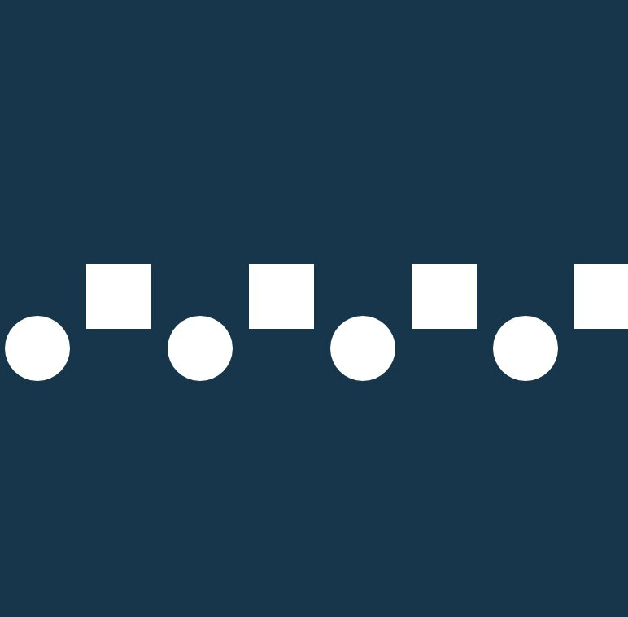
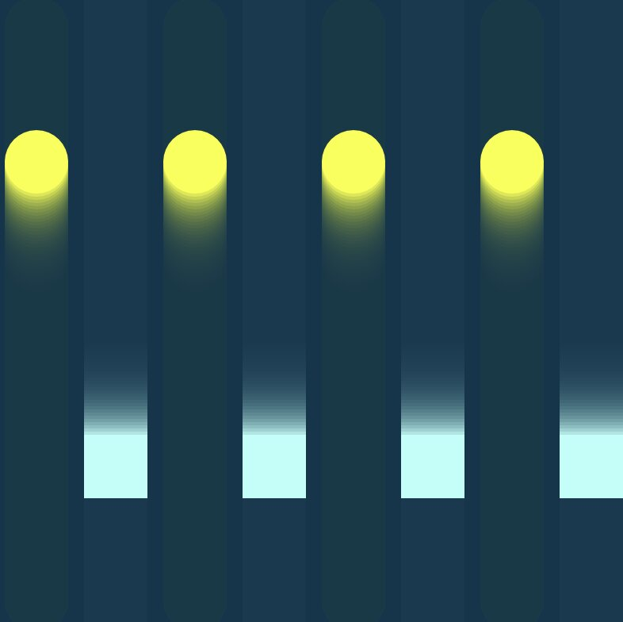
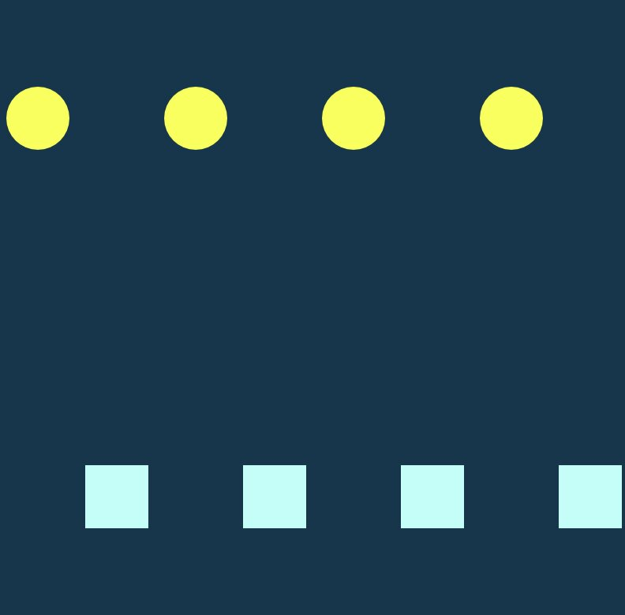

# Week 02 — control flaws and interactivity

<!-- Replace ## with the week number and Topic Name with the week's focus -->
<!-- You may also refer to each week's slide for the Topic Name -->
<!-- e.g. Week 03 — Arrays & Functions -->

---

### Activities

| Activity | What I Made |
| -------- | ----------- |
| `2a` | Bouncing ball |
| `2b` | Alternating shapes |

<!-- Add or remove rows to match the activities for this week. -->

---

### This Week

<Learned to use trail and how to use for loop, modulo structures to make interesting animations. Tried to do the buncing effect by consulting prof>

---

### Output

<It bounces and changes colour when clicked

 
 

[Watch Online](https://drive.google.com/file/d/1v3FCYMFxhYNNjkLCVZlotiBtvYoDf278/view?usp=sharing)
 
 

[Watch Online](https://drive.google.com/file/d/1Q-c0X8bOtFwcNKUkDpfTiwHYH9aSVO9L/view?usp=sharing)

<!-- Drop a screenshot, photo, or GIF of something you made this week.
     Save it to a readme-assets/ folder inside this week's folder.
     Made more than one thing worth showing? Add more images. -->

---

<!-- ─────────────────────────────────────────────────────
     GOING FURTHER — if you want to document more, here are some ideas:

     ### 1a — Activity Name
     
     What you tried, what you discovered.

     ### 1b — Activity Name
     
     What you tried, what you discovered.

     ### 🧩 Something I Found Interesting
     A line of code, a technique, a happy accident — paste it here.
     ```js
     // your code here
     ```

     ### ❓ Questions I'm Sitting With
     Anything unresolved, something you want to revisit, or a rabbit hole you fell into.

     ### 🔗 References
     Links to anything that helped or inspired you this week.
     ───────────────────────────────────────────────────── -->
