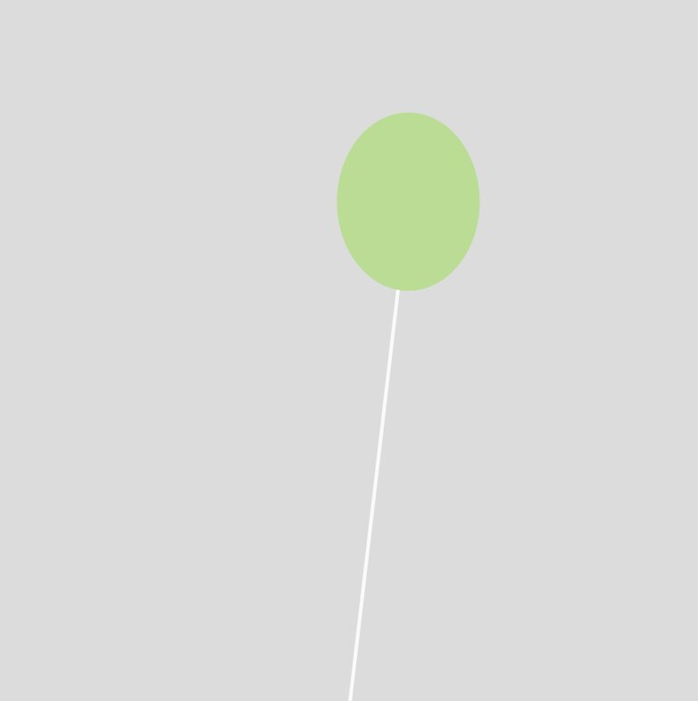
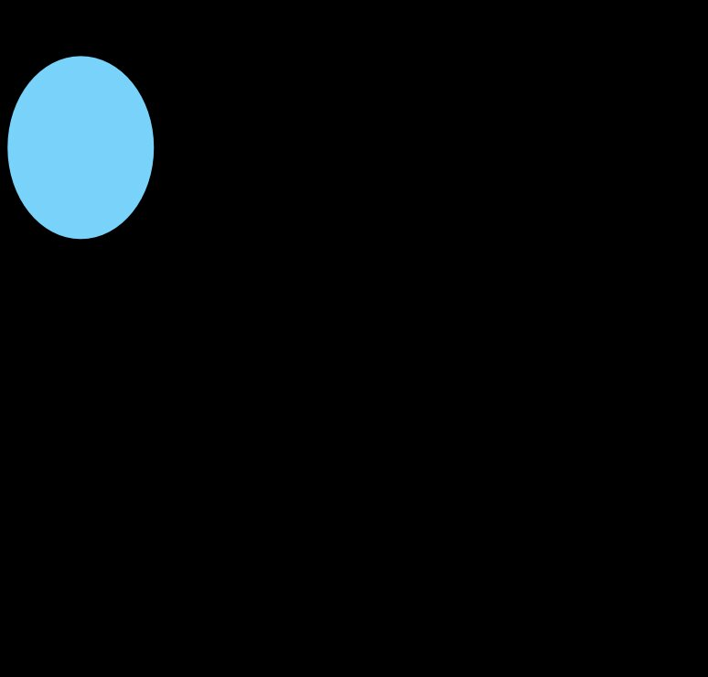

# Week 03 — arrays, functions, transformatics

<!-- Replace ## with the week number and Topic Name with the week's focus -->
<!-- You may also refer to each week's slide for the Topic Name -->
<!-- e.g. Week 03 — Arrays & Functions -->

---

### Activities

| Activity | What I Made |
| -------- | ----------- |
| `3a` | Shocked and not shocked face |
| `3b` | moving colourful balloons tied to the ground |

<!-- Add or remove rows to match the activities for this week. -->

---

### This Week

<made use of more arrays and functions, including randomness from prevous lessons>
---

### Output


 

[Watch Online](https://drive.google.com/file/d/1aqg6OmNeerhYOPDtUHC3kt-UoCga6nCe/view?usp=share_link)
[Watch Online](https://drive.google.com/file/d/1HRZSDFonV6EJOg7XQs4d7BxdlnTgmN0h/view?usp=sharing)
[Watch Online](https://drive.google.com/file/d/1oBnEhCjayXrqJKY9bKRkKY9rgRfn_7mV/view?usp=sharing)

<!-- Drop a screenshot, photo, or GIF of something you made this week.
     Save it to a readme-assets/ folder inside this week's folder.
     Made more than one thing worth showing? Add more images. -->

---

<!-- ─────────────────────────────────────────────────────
     GOING FURTHER — if you want to document more, here are some ideas:

     ### 1a — Activity Name
     
     What you tried, what you discovered.

     ### 1b — Activity Name
     
     What you tried, what you discovered.

     ### 🧩 Something I Found Interesting
     A line of code, a technique, a happy accident — paste it here.
     ```js
     // your code here
     ```

     ### ❓ Questions I'm Sitting With
     Anything unresolved, something you want to revisit, or a rabbit hole you fell into.

     ### 🔗 References
     Links to anything that helped or inspired you this week.
     ───────────────────────────────────────────────────── -->
