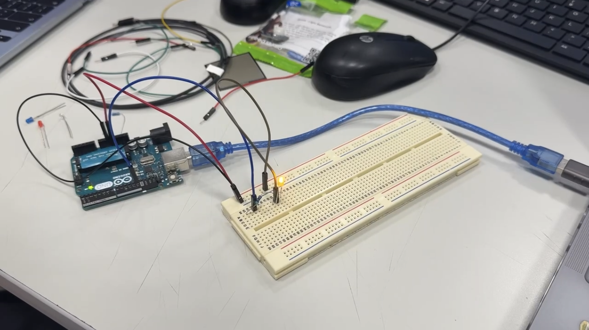
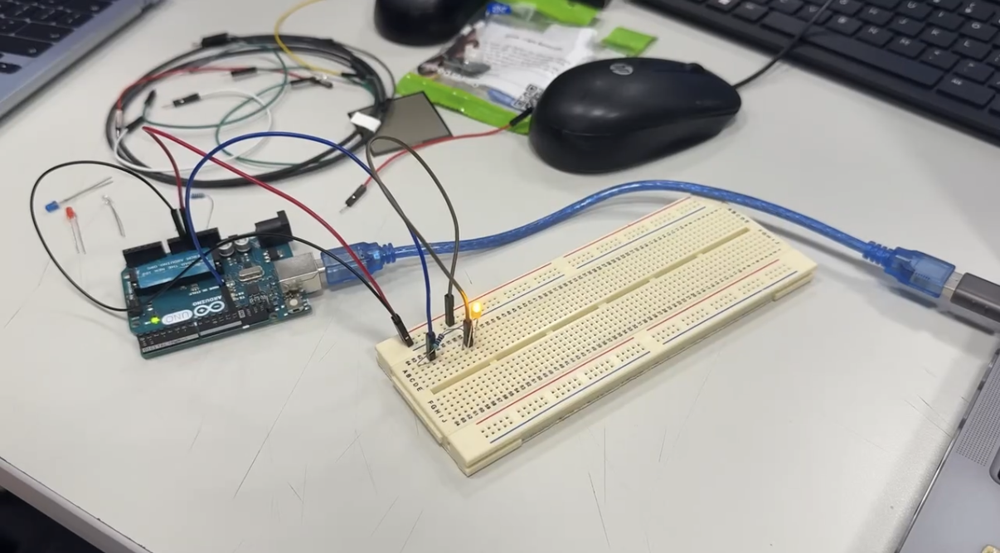
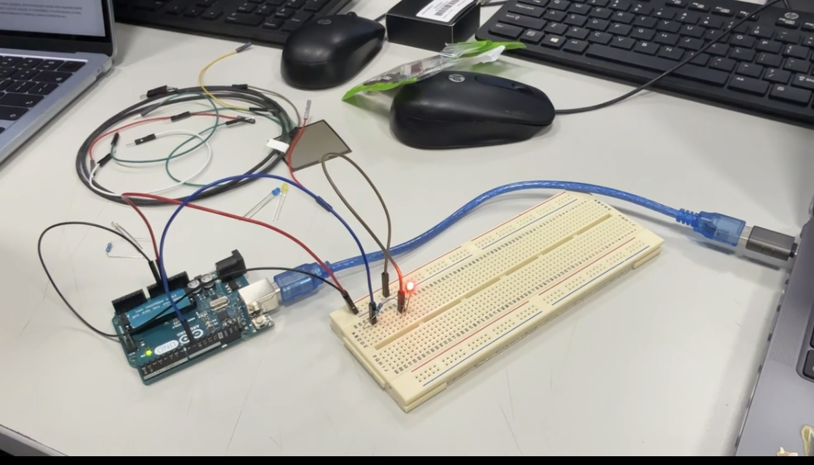
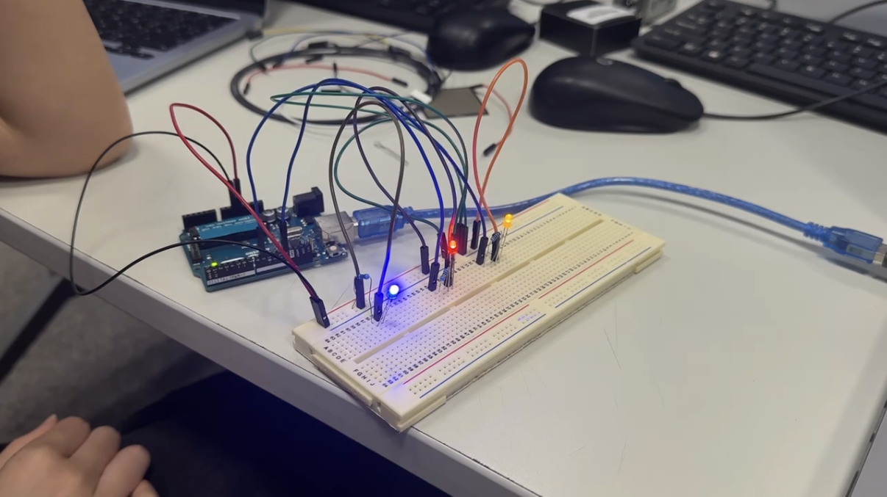
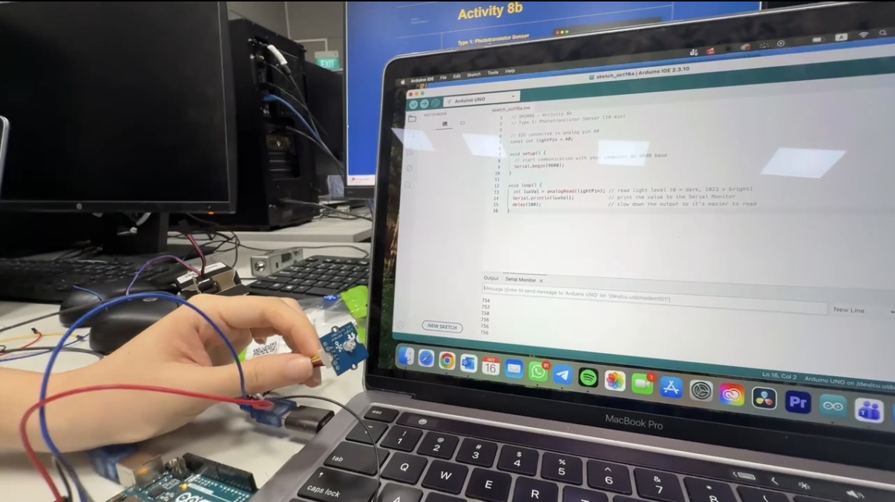
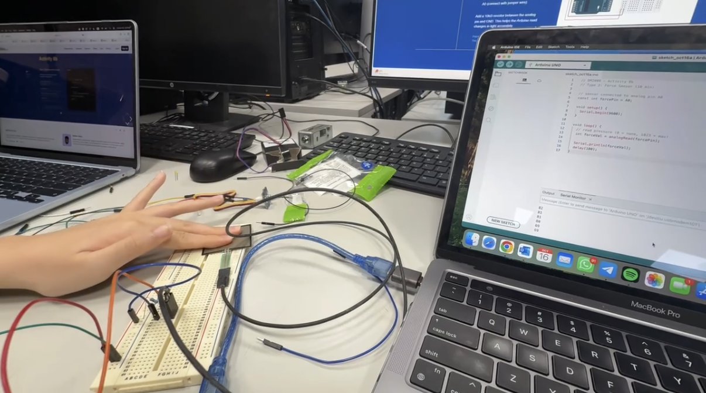
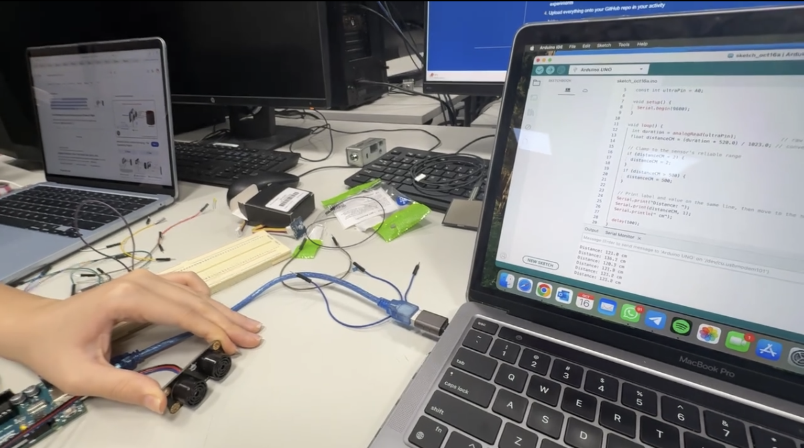

# Week 8 — Arduno Basics

<!-- Replace ## with the week number and Topic Name with the week's focus -->
<!-- You may also refer to each week's slide for the Topic Name -->
<!-- e.g. Week 03 — Arrays & Functions -->

---

### Activities

| Activity | What I Made |
| -------- | ----------------------------- |
| 8a | <Control the LED with code> |
| 8b | <Using different sensors to see how they respond to changes in the environment> |

<!-- Add or remove rows to match the activities for this week. -->

---

### This Week

<First time exploring Arduino to try out physical computing and figuring out wiring basics to make code come alive through physical interactions. Understanding how the breadboard and the different elements (LED, resistors etc) work together.>

---

### Output

### 🎥 Demo Video
[video8a] <https://drive.google.com/file/d/1dUQIYDegsiJ3hL7kGB47jtsrs6gcWhA6/view?usp=drive_link>
[video8b-type1] <https://drive.google.com/file/d/1f4rm21agoHFToqzrAipMm5xhwYpEtyan/view?usp=drive_link>
[video8b-type2] <https://drive.google.com/file/d/1l1k2-WVBbekJiZ7aKYh1nDvf8paQGimj/view?usp=drive_link>
[video8b-type3] <https://drive.google.com/file/d/1CZyB0Fa5eCix_tnD9FPHuTgDsnl0TA2X/view?usp=drive_link>

<!-- Drop a screenshot, photo, or GIF of something you made this week.
Save it to a readme-assets/ folder inside this week's folder.
Made more than one thing worth showing? Add more images. -->

---

<!-- ─────────────────────────────────────────────────────
GOING FURTHER — if you want to document more, here are some ideas:

### 1a — Activity Name

What you tried, what you discovered.

### 1b — Activity Name

What you tried, what you discovered.

### 🧩 Something I Found Interesting
A line of code, a technique, a happy accident — paste it here.
// your code here
### ❓ Questions I'm Sitting With
Anything unresolved, something you want to revisit, or a rabbit hole you fell into.

### 🔗 References
Links to anything that helped or inspired you this week.
───────────────────────────────────────────────────── -->