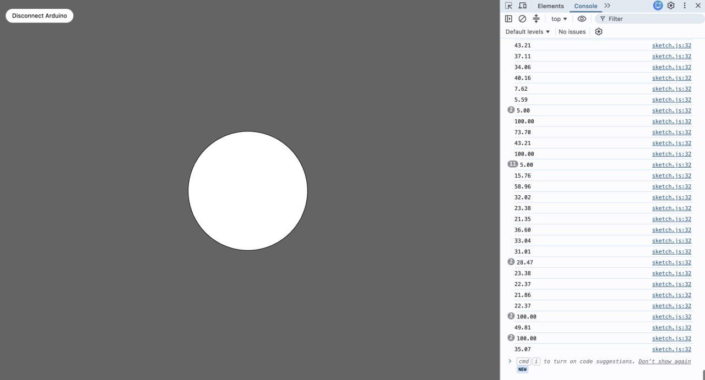
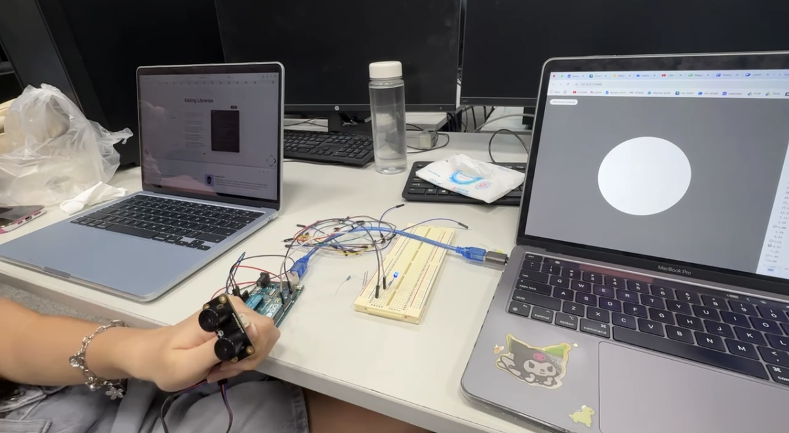

# Sensor Jam — Light sensor visualiser

<!-- Replace "Title" with the name of your project, e.g. "Sensor Jam — Theremin Visualiser" -->

---

### The Project

<My sketch is driven by sound input, using sound waves detected by the sensor. The sensor picks up changes in sound levels and translates them into visual changes on the screen, allowing the visuals to respond dynamically to the surrounding audio environment.>

---

### Output

<!-- Drop a screenshot or GIF of your sketch in action.
Got a photo of your physical setup too? Throw it in.
Save everything to a readme-assets/ folder inside this project folder. -->
[video1] (https://drive.google.com/file/d/13leNgkDy5uaeQKVbDbMoeyDSZObOAo6p/view?usp=sharing)
[video2] (https://drive.google.com/file/d/1_V3I_7iStd1vDyQrg7R_6iJ1ZfJbX6Tj/view?usp=drive_link)

<!-- Replace the link above with a URL to a video of your project in action.
⚠️ Make sure the file or page is set to public before submitting. -->

---

<!-- ─────────────────────────────────────────────────────
GOING FURTHER — want to document more? Try any of these:

### ✍️ Reflection
A short write-up of your process — what worked, what didn't,
and what you'd take further if you had more time.

### 🛠 Hardware
List the physical components you used.
- Arduino Uno
- Ultrasonic sensor (HC-SR04)

### 🔍 Sensor Mapping
How does your sensor data map to visual or sonic output?
e.g. "Distance (0–400cm) → circle size (10–400px) using map()"

### 🧩 Something I Found Interesting
A snippet, a technique, a happy accident.
// your code here
### 🔗 References
Anything that helped — tutorials, datasheets, examples.
───────────────────────────────────────────────────── --