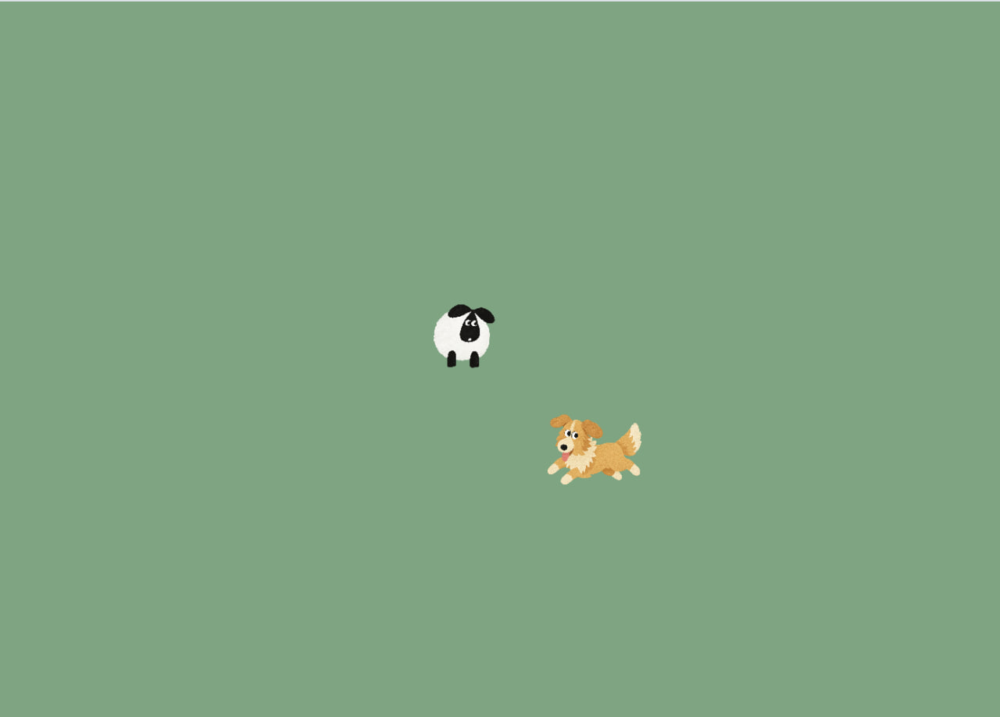
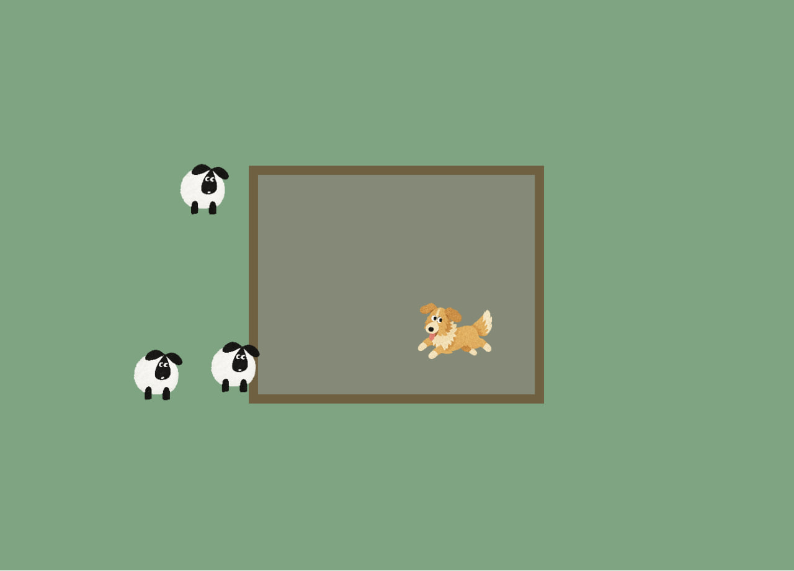
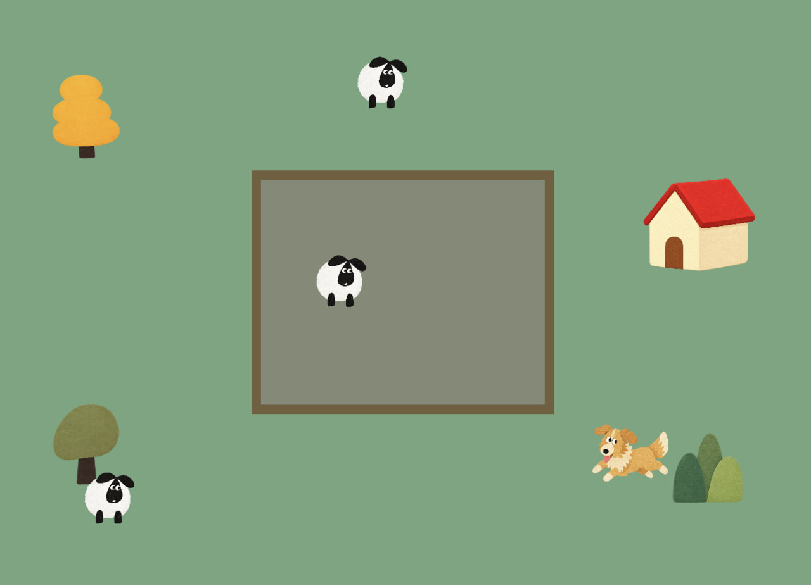
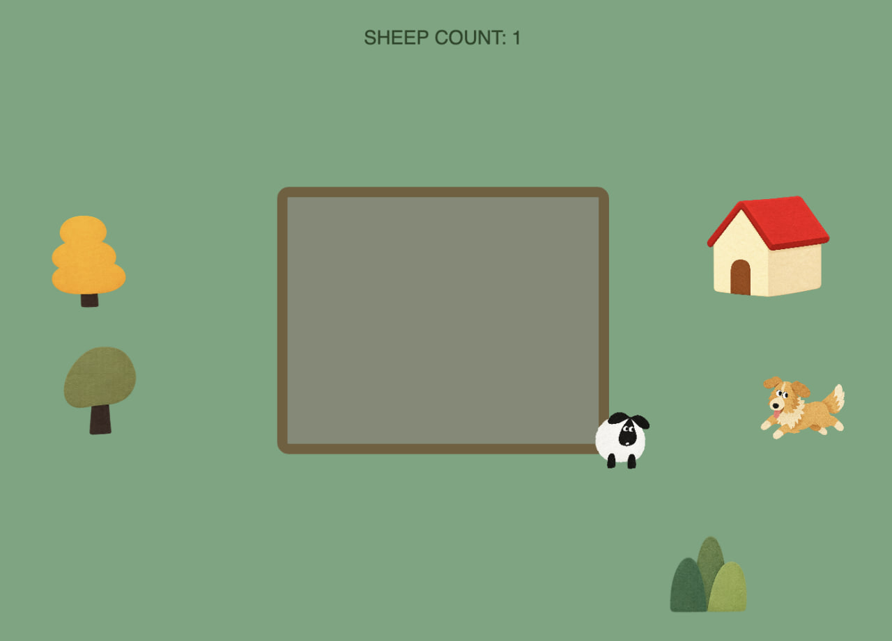
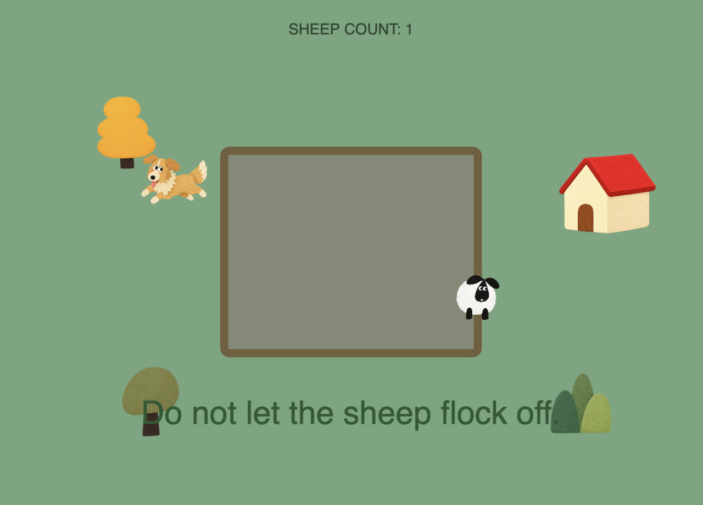

# Final Project — Flock Off

<!-- Replace "Title" with the name of your project -->

---

### The Project

<!-- What is your project and what does it do?
     Flock Off! is an interactive sheep-herding game where players control a sheepdog using their mouse to guide wandering sheep into a fenced enclosure. Instead of controlling the sheep directly, players must strategically position the dog to influence their movements. As the number of sheep increases with each stage, the game becomes increasingly chaotic and challenging. Set in a playful countryside environment, Flock Off! creates a lighthearted experience that tests players' patience, coordination and ability to keep their flock together.

---

### Output






[video01](https://drive.google.com/file/d/1tEjJeI85-iA_NYKBXfEPgxT-XPesMqr-/view?usp=drive_link)
[video02](https://drive.google.com/file/d/1q_7foy5ghyQGzCKRDjy3Vs4LG2EEpN5_/view?usp=drive_link)
[video03](https://drive.google.com/file/d/1beXX9qqgRGSVbmZcnmbGTAzhGl45QZ5Y/view?usp=drive_link)
[video04](https://drive.google.com/file/d/1XIROEb-zKo8WTm-NY1bTrlczkU9xgwUW/view?usp=drive_link)
[video05](https://drive.google.com/file/d/18xMEdLWJHX1r7jjhO-vNDlsrafHjqyfO/view?usp=drive_link)


---

### ✍️ Reflection

### A) Concept & Intent

Our project is an interactive sheep-herding game where players control a dog to guide wandering sheep into a fenced area. We wanted to create a playful yet increasingly challenging experience that requires players to strategise and control their movements rather than simply move objects directly. I worked with Jingyi to ideate something visually interesting. 

### 😎 Interaction Logic

The game uses mouse input, with the dog following the cursor's position. When the dog approaches a sheep within a certain distance, the sheep moves in the opposite direction. Players must therefore position the dog strategically to guide the sheep towards the enclosure. The concept was finalised following this interaction as well.

### C) Technical Structure

The project utilises object-oriented programming, with a Sheep class managing each sheep's position, movement and behaviour. An array stores multiple sheep, while conditional statements and game states manage stage progression, completion and game-over conditions. I referred much of Week 4's activity 4b to mirror the sheep-wandering movements, and much of our mini-project game states and collision check concepts in crafting our final project. We also ensured to kept the visual interacton more smooth by letting the sheeps glide across instead being pushed away sharply, which also adds to our silly art style and tone of voice for the game.

### D) Behaviour Over Time

The game progresses across three stages, with the number of sheep increasing at each stage. As sheep wander independently, players must manage multiple moving objects simultaneously. The game ends unsuccessfully if a sheep escapes the canvas.

### E) Aesthetic Decisions

We incorporated illustrated assets of sheep, a dog, trees and a house to establish a playful countryside setting. These visual elements make the interaction more intuitive, while creating a cohesive and immersive game environment. We wanted a flat colour, vector-art style but with subtle textures to simulate that of the grass. Jing Yi suggested adding an Windows-style error pop-up as the stage over page because it suited the slightly cheeky tone of the game. 

### F) Iteration & Challenges

The project initially began as a burger-assembly game, where players pushed ingredients onto a plate using mouse movements. We realised that the repulsion mechanic could be more meaningfully applied to sheep herding. One significant challenge was balancing the sheep's independent wandering behaviour with their responsiveness to the dog. Through adjusting movement parameters and introducing progressive stages, we developed a more engaging and purposeful gameplay experience.

---

<!-- ─────────────────────────────────────────────────────
     GOING FURTHER — want to document more? Try any of these:

     ### ✨ Features
     A short list of what your project does.
     - Responds to mouse position and velocity
     - Generates sound based on particle density

     ### 🔍 Code Structure
     How are your files organised?
     - `sketch.js` — main setup and draw loop
     - `Agent.js` — autonomous agent class
     - `assets/` — images and sounds

     ### 🛠️ Hardware (if applicable)
     List any physical components used.
     - Arduino Uno
     - Sensor type and model

     ### 🧩 Something I'm Proud Of
     A snippet, a decision, a moment where it all came together.
     ```js
     // your code here
     ```

     ### 🔗 References
     Tutorials, libraries, artworks, or research that informed your project.
     ───────────────────────────────────────────────────── -->
